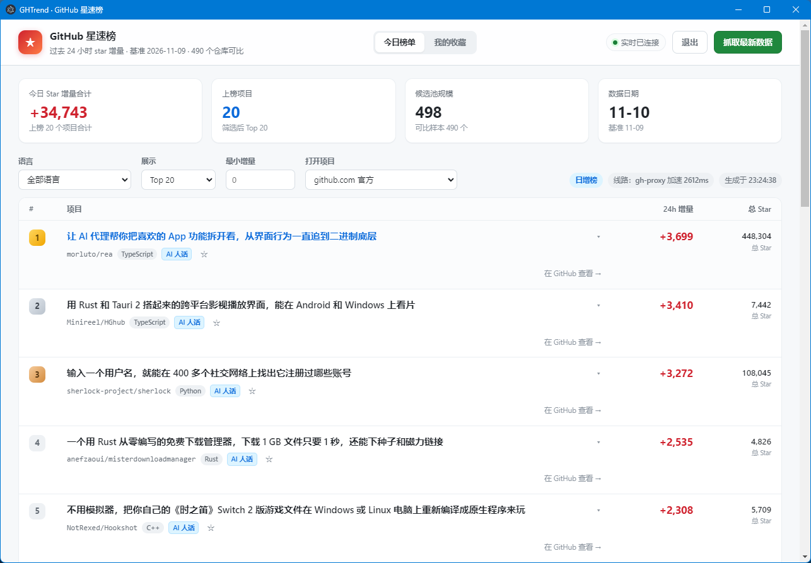
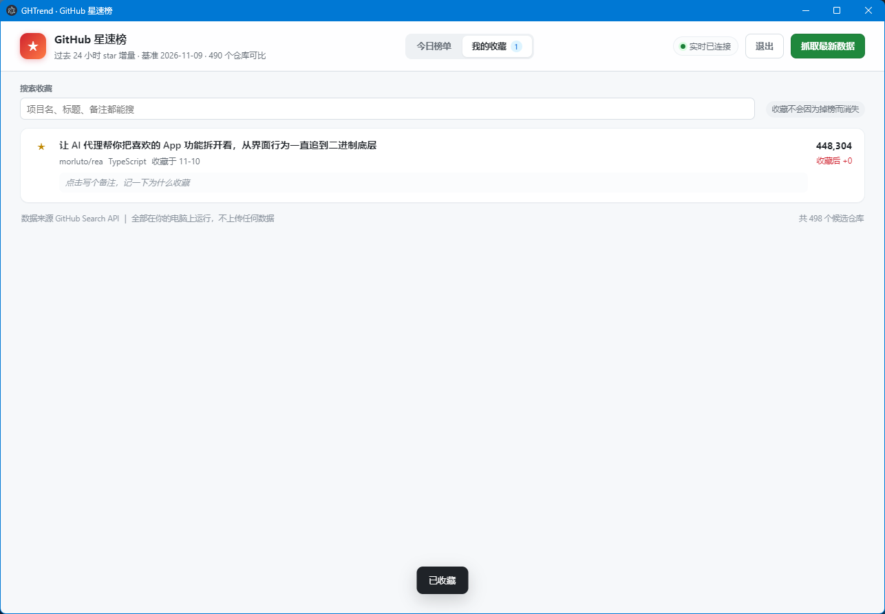

# GHTrend

> 记住你看好过的每个开源项目，它后来涨了多少。
>
> _Track the star velocity of GitHub repos — and what happened to the ones you starred._

GitHub 官方 Trending 告诉你「今天谁火」，但它只给 25 条、只按它自己的黑盒算法排、不保留任何历史，也不会替你记住**你三个月前收藏它的时候是多少 star**。

GHTrend 做三件官网不做的事：

1. **全量池子，不是 Top 25** —— 每天扫 498 个活跃仓库，按语言、增速阈值、Top N 任意筛
2. **给每条涨幅一个中文解释** —— 不是翻译 description，而是说清「它今天为什么涨」
3. **替你记账** —— 收藏时记下 star，之后每次打开都告诉你：**你当初看好的这个项目，涨了多少**

数据全部在你自己的电脑上，不上传任何一个字节。



---

## 和同类工具的区别

|  | GitHub 官方 Trending | Trendshift | HelloGitHub | **GHTrend** |
|---|---|---|---|---|
| 日增 star 排名 | ✅ 25 条 | ✅ | ❌ | ✅ 498 池 |
| 按增速阈值筛选 | ❌ | ❌ | ❌ | ✅ |
| 中文 AI 解读 | ❌ | ❌ | ✅ 人工 | ✅ |
| 记住「收藏后涨了多少」 | ❌ | 仅 bookmark | ❌ | ✅ |
| 数据留在本地 | — | ❌ | ❌ | ✅ |
| 需要安装 | ❌ 免安装 | ❌ 免安装 | ❌ 免安装 | ⚠️ Windows 桌面版 |

**说实话的部分**：Trendshift 免安装、有服务器每天帮你抓、还能更早发现上升中的项目，这些它比 GHTrend 强。GHTrend 唯一不可替代的是最后两行——**本地数据**和**你个人的持仓涨幅**。

---

## 功能

- **日增榜**：今天 vs 昨天的 star 差值排名，可切语言 / Top 10–50 / 最小增量
- **新星榜**：只有一份快照时的降级方案，按 `star ÷ 项目年龄` 排
- **断档折算**：中间缺了几天就按日均折算，并在顶部明确告诉你缺了几天
- **AI 中文解读**：一句话标题 + 详细解读，失败自动降级为规则标签，可单条重生成
- **收藏追踪**：收藏时 star、当前 star、收藏后涨幅、备注、搜索，掉榜不消失
- **多线路自动选路**：官方 / gh-proxy 并发探测，按延迟选最快的
- **断点续抓**：分页结果本地缓存，网络断了下次接着抓
- **实时进度**：SSE 推送，抓取期间可以继续看旧榜单
- **可选推送**：企业微信 Webhook / SMTP 邮件日报

收藏页记着每个项目的「收藏时 star / 当前 star / 收藏后涨幅」，掉出榜单也不会消失：



---

## 快速开始

### 方式一：下载桌面版（推荐，无需 Python / Node）

到 [Releases](../../releases/latest) 下载：

| 文件 | 说明 |
|---|---|
| `GHTrend-x.x.x-x64.exe` | 安装版，可选安装目录，自动建桌面和开始菜单快捷方式 |
| `GHTrend-x.x.x-portable-x64.exe` | 免安装版，双击即用，适合放 U 盘或不愿写注册表 |

> 未做代码签名，首次运行 Windows SmartScreen 会提示「已保护你的电脑」→ 点「更多信息」→「仍要运行」。
> 国内杀软也可能误报 Electron 打包程序，加入信任即可。

第一次打开点右上角「抓取最新数据」，等 1 分钟左右出榜单。

### 方式二：从源码跑（零第三方依赖）

```bash
git clone https://github.com/HH-yy5/ghtrend.git
cd ghtrend

python ghtrend.py demo     # 零配置、不联网，先看看长什么样
python ghtrend.py init     # 生成 config.json 模板
python ghtrend.py top      # 看今天的日增榜
```

只依赖 Python 3.9+ 标准库，**不需要 pip install 任何东西**。

启动带界面的本地服务：

```bash
python server.py           # 默认 http://127.0.0.1:8765
```

或双击 `launch.bat`（Windows）。

---

## 配置

复制模板后填入自己的值：

```bash
cp config.example.json config.json
```

| 字段 | 说明 |
|---|---|
| `github.token` | 可选。填了速率从 10 次/分提到 30 次/分，减少限流失败 |
| `github.proxy` | 可选。如 `http://127.0.0.1:7890`。**填了但代理没开会比不填更糟** |
| `github.core_min_stars` / `core_pages` | 候选池主查询：star 门槛与页数（默认 500 / 3） |
| `github.new_min_stars` / `new_pages` | 新项目查询：默认 100 / 2 |
| `llm` | 任意 OpenAI 兼容接口（DeepSeek / OpenAI / 本地模型均可）。`enabled: false` 即关闭 |
| `notify` | 企业微信 Webhook、SMTP 邮件 |

`config.json` 已被 `.gitignore` 排除，**不要提交它**。

---

## 命令行

```bash
python ghtrend.py demo                    # 零配置离线体验
python ghtrend.py top --top 30            # 今日日增榜 Top 30
python ghtrend.py daily                   # 抓取 + 生成今日快照
python ghtrend.py daily --report --notify # 一键日报（定时任务用这个）
python ghtrend.py show torvalds/linux     # 某个仓库的本地 star 历史
python ghtrend.py config                  # 查看当前配置状态
```

---

## 架构

```
ghtrend.py     # 引擎：抓取 / 存储 / 计算 / 增强 / 展现，五层分离（约 3000 行）
server.py      # 本地 HTTP 服务：复用引擎，加 SSE 与静态白名单（约 1000 行）
web/           # 前端：原生 HTML + CSS + JS，无框架无构建
electron/      # 桌面外壳：起停后端、拦截外链到系统浏览器
tools/         # 图标生成、抓取自测
```

设计取舍：

- **零依赖优先**：引擎只用标准库，clone 就能跑，不装环境也能验证
- **只监听 127.0.0.1**：不对外暴露；静态文件走白名单，杜绝路径穿越；空闲 30 分钟自动退出
- **诚实降级**：没基线就出新星榜，没 LLM 就出规则摘要，不报错也不空转

---

## 已知限制

- **数据连续性依赖本机每天运行**。断档就按日均折算，榜单会失真。这是当前架构的硬伤，未来计划用 GH Archive 回填历史
- **首次使用会看到「新星榜」**，要等第二天才有真正的日增榜
- **只支持 Windows**（Electron 壳按 Windows 打包）
- 桌面版体积约 230MB（Electron + 打包后的 Python 运行时），偏大
- 未做代码签名

---

## 隐私

无账号、无遥测、无云端。所有快照、收藏、日志都在本地 `data/` 和 `logs/` 目录，删掉即清空。
唯一的外发请求是 GitHub API 和你自己配置的 LLM 接口。

---

## 参与

Issue 和 PR 都欢迎。如果它帮到了你，点个 Star 是最大的支持。

---

## License

[MIT](LICENSE)

GHTrend 是独立开源项目，**与 GitHub, Inc. 无任何关联**，也未获得其背书。GitHub 是其所有者的注册商标。
